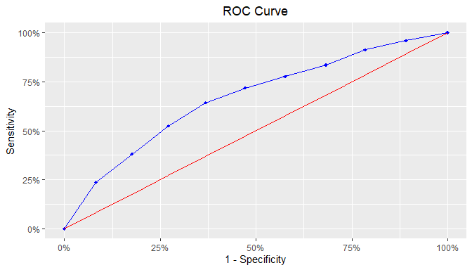

<!-- README.md is generated from README.Rmd. Please edit that file -->

# blorr

<!-- badges: start -->

[](https://CRAN.R-project.org/package=blorr)
[](https://github.com/rsquaredacademy/blorr/actions/workflows/R-CMD-check.yaml)
[](https://app.codecov.io/gh/rsquaredacademy/blorr?branch=develop)
<!-- badges: end -->

blorr helps analysts build and validate binary logistic regression
models, with clear output, model checks and selection tools.

## Installation

``` r
# Release version from CRAN
install.packages("blorr")

# Development version from GitHub
# install.packages("pak")
pak::pak("rsquaredacademy/blorr")
```

## Quick example

### Read the regression output

Which bank clients are likely to subscribe to a term deposit?

This example uses 4,521 clients from a Portuguese bank marketing
campaign. The response `y` is 1 for a subscription and 0 otherwise.

``` r
model <- glm(y ~ campaign + previous + housing + loan,
             data = bank_marketing, family = binomial(link = "logit"))
blr_regress(model)
#>                                 Model Overview                                 
#> ------------------------------------------------------------------------------
#>       Data Set    Resp Var    Obs.    Df. Model    Df. Residual    Convergence 
#> ------------------------------------------------------------------------------
#> bank_marketing       y        4521        4            4516           TRUE     
#> ------------------------------------------------------------------------------
#> 
#>                     Response Summary                     
#> --------------------------------------------------------
#> Outcome        Frequency        Outcome        Frequency 
#> --------------------------------------------------------
#>    0             4004              1              517    
#> --------------------------------------------------------
#> 
#>                    Maximum Likelihood Estimates                    
#> ------------------------------------------------------------------
#>  Parameter     DF    Estimate    Std. Error    z value     Pr(>|z|) 
#> ------------------------------------------------------------------
#> (Intercept)    1     -2.8653        0.1735    -16.5170      0.0000 
#>  campaign      1     -0.1335        0.0264     -5.0609      0.0000 
#>  previous      1      0.1285        0.0211      6.0889      0.0000 
#>  housingno     1      0.8363        0.0971      8.6138      0.0000 
#>   loanno       1      0.7185        0.1633      4.4008      0.0000 
#> ------------------------------------------------------------------
#> 
#>  Association of Predicted Probabilities and Observed Responses   
#> ----------------------------------------------------------------
#> % Concordant         64.5775          Somers' D         0.3426   
#> % Discordant         30.3185          Gamma             0.3610   
#> % Tied                5.1040          Tau-a             0.0694   
#> Pairs                2070068          c                 0.6713   
#> ----------------------------------------------------------------
```

More campaign contacts go with a lower chance of subscribing (-0.13). A
previous contact (+0.13), no housing loan (+0.84) and no personal loan
(+0.72) go with a higher chance.

An estimate is the change in log-odds for a one-unit increase in a
predictor. Log-odds are a chance score: 0 is even odds, and positive
values mean a higher chance.

A p-value is the chance of an estimate this large if the predictor had
no effect. All four are below 0.0001, though they print as 0.0000.

`c` (0.6713) is the share of subscriber and non-subscriber pairs the
model ranks correctly. A value of 0.5 is a coin flip; 1 is perfect.

### Choose a cut-off

Which clients should the bank call first?

A cut-off is the predicted probability above which a client is flagged
as a likely subscriber.

Only 517 of the 4,521 clients subscribe, about one in nine. A cut-off of
0.15 therefore flags more subscribers than the usual 0.5, at the cost of
more false alarms.

``` r
cm <- blr_confusion_matrix(model, data = bank_marketing, cutoff = 0.15)
cm$conf_matrix
#>           Reference
#> Prediction    0    1
#>          0 2912  244
#>          1 1092  273
round(c(accuracy = cm$accuracy, no_information_rate = cm$no_information_rate,
        sensitivity = cm$sensitivity, specificity = cm$specificity), 4)
#>            accuracy no_information_rate         sensitivity         specificity 
#>              0.7045              0.8856              0.5280              0.7273
```

At a cut-off of 0.15, the model catches 273 of 517 subscribers and
clears 2,912 of 4,004 non-subscribers.

Sensitivity is the share of real subscribers flagged (0.5280).
Specificity is the share of non-subscribers left unflagged (0.7273).

Accuracy (0.7045) is the overall share correct, but calling nobody would
score 0.8856, because most clients do not subscribe.

### Rank clients with an ROC curve

How well does the model separate subscribers from non-subscribers?

``` r
gains <- blr_gains_table(model, data = bank_marketing)
blr_roc_curve(gains)
```



The curve sits above the red chance line, so the model ranks subscribers
above non-subscribers more often than chance.

The ROC curve plots sensitivity against 1 - specificity as the cut-off
moves. The red line is chance. The area under the curve is `c`, 0.6713.

## Learn more

- [Documentation site](https://blorr.rsquaredacademy.com)
- Vignettes:
  - [A Short Introduction to the blorr
    Package](https://blorr.rsquaredacademy.com/articles/introduction.html)
- [NEWS](https://blorr.rsquaredacademy.com/news/index.html)

## Getting help and contributing

**Help:** open an
[issue](https://github.com/rsquaredacademy/blorr/issues) with a minimal
reproducible example, built with
[reprex](https://reprex.tidyverse.org/).

**Contributing:** read the [contributing
guide](https://github.com/rsquaredacademy/blorr/blob/develop/.github/CONTRIBUTING.md).

**Code of Conduct:** Please note that the blorr project is released with
a [Contributor Code of
Conduct](https://blorr.rsquaredacademy.com/CODE_OF_CONDUCT.html). By
contributing to this project, you agree to abide by its terms.

**Citation:** run `citation("blorr")`. The [authors
page](https://blorr.rsquaredacademy.com/authors.html) lists the package
authors.

<div data-rsa-signup="" data-site="blorr.rsquaredacademy.com"
data-privacy-url="https://www.rsquaredacademy.com/privacy-policy.html">

</div>
