# A Short Introduction to the blorr Package

## Introduction

The blorr package offers tools for building and validating binary
logistic regression models. It is most suitable for
beginner/intermediate R users and those who teach statistics using R.
The API is very simple and most of the functions take either a
`data.frame`/`tibble` or a `model` as input. **blorr** use consistent
prefix **blr\_** for easy tab completion.

### Installation

You can install **blorr** using:

[`install.packages`](https://rdrr.io/r/utils/install.packages.html)`(``"blorr"``)`

The documentation of the package can be found at
<https://blorr.rsquaredacademy.com>. This vignette gives a quick tour of
the package.

### Libraries

The following libraries are used in the examples in the vignette:

[`library`](https://rdrr.io/r/base/library.html)`(`[`blorr`](https://blorr.rsquaredacademy.com/)`)`` `[`library`](https://rdrr.io/r/base/library.html)`(`[`magrittr`](https://magrittr.tidyverse.org)`)`

## Data

To demonstrate the features of blorr, we will use the bank marketing
data set. The data is related with direct marketing campaigns of a
Portuguese banking institution. The marketing campaigns were based on
phone calls. Often, more than one contact to the same client was
required, in order to access if the product (bank term deposit) would be
(‘yes’) or not (‘no’) subscribed. It contains a random sample (~4k) of
the original data set which can be found at
<https://archive.ics.uci.edu/ml/datasets/bank+marketing>.

## Bivariate Analysis

Let us begin with careful bivariate analysis of each possible variable
and the outcome variable. We will use information value and likelihood
ratio chi square test for selecting the initial set of predictors for
our model. The bivariate analysis is currently avialable for categorical
predictors only.

[`blr_bivariate_analysis`](https://blorr.rsquaredacademy.com/reference/blr_bivariate_analysis.md)`(``bank_marketing``, ``y``, ``job``, ``marital``, ``education``, ``default``, `` `` ``housing``, ``loan``, ``contact``, ``poutcome``)`` ``#> Bivariate Analysis `` ``#> ----------------------------------------------------------------------`` ``#> Variable Information Value LR Chi Square LR DF LR p-value `` ``#> ----------------------------------------------------------------------`` ``#> job 0.16 75.2690 11 0.0000 `` ``#> marital 0.05 21.6821 2 0.0000 `` ``#> education 0.05 25.0466 3 0.0000 `` ``#> default 0.02 6.0405 1 0.0140 `` ``#> housing 0.16 72.2813 1 0.0000 `` ``#> loan 0.06 26.6615 1 0.0000 `` ``#> contact 0.31 124.3834 2 0.0000 `` ``#> poutcome 0.53 270.6450 3 0.0000 `` ``#> ----------------------------------------------------------------------`

### Weight of Evidence & Information Value

Weight of evidence (WoE) is used to assess the relative risk of di¤erent
attributes for a characteristic and as a means to transform
characteristics into variables. It is also a very useful tool for
binning. The WoE for any group with average odds is zero. A negative WoE
indicates that the proportion of defaults is higher for that attribute
than the overall proportion and indicates higher risk.

The information value is used to rank order variables in terms of their
predictive power. A high information value indicates a high ability to
discriminate. Values for the information value will always be positive
and may be above 3 when assessing highly predictive characteristics.
Characteristics with information values less than 0:10 are typically
viewed as weak, while values over 0.30 are sought after.

[`blr_woe_iv`](https://blorr.rsquaredacademy.com/reference/blr_woe_iv.md)`(``bank_marketing``, ``job``, ``y``)`` ``#> Weight of Evidence `` ``#> --------------------------------------------------------------------------------`` ``#> levels count_0s count_1s dist_0s dist_1s woe iv `` ``#> --------------------------------------------------------------------------------`` ``#> management 809 130 0.20 0.25 -0.22 0.01 `` ``#> technician 682 79 0.17 0.15 0.11 0.00 `` ``#> entrepreneur 139 12 0.03 0.02 0.40 0.00 `` ``#> blue-collar 937 73 0.23 0.14 0.51 0.05 `` ``#> unknown 29 2 0.01 0.00 0.61 0.00 `` ``#> retired 152 47 0.04 0.09 -0.87 0.05 `` ``#> admin. 433 61 0.11 0.12 -0.09 0.00 `` ``#> services 392 39 0.10 0.08 0.26 0.01 `` ``#> self-employed 132 22 0.03 0.04 -0.26 0.00 `` ``#> unemployed 126 15 0.03 0.03 0.08 0.00 `` ``#> housemaid 110 12 0.03 0.02 0.17 0.00 `` ``#> student 63 25 0.02 0.05 -1.13 0.04 `` ``#> --------------------------------------------------------------------------------`` ``#> `` ``#> Information Value `` ``#> -----------------------------`` ``#> Variable Information Value `` ``#> -----------------------------`` ``#> job 0.1594 `` ``#> -----------------------------`

#### Plot

`k`` ``<-`` `[`blr_woe_iv`](https://blorr.rsquaredacademy.com/reference/blr_woe_iv.md)`(``bank_marketing``, ``job``, ``y``)`` `[`plot`](https://rdrr.io/r/graphics/plot.default.html)`(``k``)`

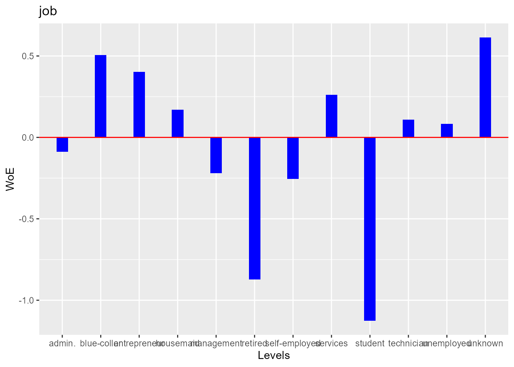

#### Multiple Variables

We can generate the weight of evidence and information value for
multiple variables using
[`blr_woe_iv_stats()`](https://blorr.rsquaredacademy.com/reference/blr_woe_iv_stats.md).

[`blr_woe_iv_stats`](https://blorr.rsquaredacademy.com/reference/blr_woe_iv_stats.md)`(``bank_marketing``, ``y``, ``job``, ``marital``, ``education``)`` ``#> Variable: job`` ``#> `` ``#> Weight of Evidence `` ``#> --------------------------------------------------------------------------------`` ``#> levels count_0s count_1s dist_0s dist_1s woe iv `` ``#> --------------------------------------------------------------------------------`` ``#> management 809 130 0.20 0.25 -0.22 0.01 `` ``#> technician 682 79 0.17 0.15 0.11 0.00 `` ``#> entrepreneur 139 12 0.03 0.02 0.40 0.00 `` ``#> blue-collar 937 73 0.23 0.14 0.51 0.05 `` ``#> unknown 29 2 0.01 0.00 0.61 0.00 `` ``#> retired 152 47 0.04 0.09 -0.87 0.05 `` ``#> admin. 433 61 0.11 0.12 -0.09 0.00 `` ``#> services 392 39 0.10 0.08 0.26 0.01 `` ``#> self-employed 132 22 0.03 0.04 -0.26 0.00 `` ``#> unemployed 126 15 0.03 0.03 0.08 0.00 `` ``#> housemaid 110 12 0.03 0.02 0.17 0.00 `` ``#> student 63 25 0.02 0.05 -1.13 0.04 `` ``#> --------------------------------------------------------------------------------`` ``#> `` ``#> Information Value `` ``#> -----------------------------`` ``#> Variable Information Value `` ``#> -----------------------------`` ``#> job 0.1594 `` ``#> -----------------------------`` ``#> `` ``#> `` ``#> Variable: marital`` ``#> `` ``#> Weight of Evidence `` ``#> ---------------------------------------------------------------------------`` ``#> levels count_0s count_1s dist_0s dist_1s woe iv `` ``#> ---------------------------------------------------------------------------`` ``#> married 2467 273 0.62 0.53 0.15 0.01 `` ``#> single 1079 191 0.27 0.37 -0.32 0.03 `` ``#> divorced 458 53 0.11 0.10 0.11 0.00 `` ``#> ---------------------------------------------------------------------------`` ``#> `` ``#> Information Value `` ``#> -----------------------------`` ``#> Variable Information Value `` ``#> -----------------------------`` ``#> marital 0.0464 `` ``#> -----------------------------`` ``#> `` ``#> `` ``#> Variable: education`` ``#> `` ``#> Weight of Evidence `` ``#> ----------------------------------------------------------------------------`` ``#> levels count_0s count_1s dist_0s dist_1s woe iv `` ``#> ----------------------------------------------------------------------------`` ``#> tertiary 1104 195 0.28 0.38 -0.31 0.03 `` ``#> secondary 2121 231 0.53 0.45 0.17 0.01 `` ``#> unknown 154 25 0.04 0.05 -0.23 0.00 `` ``#> primary 625 66 0.16 0.13 0.20 0.01 `` ``#> ----------------------------------------------------------------------------`` ``#> `` ``#> Information Value `` ``#> ------------------------------`` ``#> Variable Information Value `` ``#> ------------------------------`` ``#> education 0.0539 `` ``#> ------------------------------`

[`blr_woe_iv()`](https://blorr.rsquaredacademy.com/reference/blr_woe_iv.md)
and
[`blr_woe_iv_stats()`](https://blorr.rsquaredacademy.com/reference/blr_woe_iv_stats.md)
are currently avialable for categorical predictors only.

## Stepwise Selection

For the initial/ first cut model, all the independent variables are put
into the model. Our goal is to include a limited number of independent
variables (5-15) which are all significant, without sacrificing too much
on the model performance. The rationale behind not-including too many
variables is that the model would be over fitted and would become
unstable when tested on the validation sample. The variable reduction is
done using forward or backward or stepwise variable selection
procedures. We will use
[`blr_step_aic_both()`](https://blorr.rsquaredacademy.com/reference/blr_step_aic_both.md)
to shortlist predictors for our model.

### Model

`model`` ``<-`` `[`glm`](https://rdrr.io/r/stats/glm.html)`(``y`` ``~`` ``.``, data ``=`` ``bank_marketing``, family ``=`` `[`binomial`](https://rdrr.io/r/stats/family.html)`(``link ``=`` ``'logit'``)``)`

#### Selection Summary

[`blr_step_aic_both`](https://blorr.rsquaredacademy.com/reference/blr_step_aic_both.md)`(``model``)`` ``#> Stepwise Selection Method `` ``#> -------------------------`` ``#> `` ``#> Candidate Terms: `` ``#> `` ``#> 1 . age `` ``#> 2 . job `` ``#> 3 . marital `` ``#> 4 . education `` ``#> 5 . default `` ``#> 6 . balance `` ``#> 7 . housing `` ``#> 8 . loan `` ``#> 9 . contact `` ``#> 10 . day `` ``#> 11 . month `` ``#> 12 . duration `` ``#> 13 . campaign `` ``#> 14 . pdays `` ``#> 15 . previous `` ``#> 16 . poutcome `` ``#> `` ``#> `` ``#> Variables Entered/Removed: `` ``#> `` ``#> - duration added `` ``#> - poutcome added `` ``#> - month added `` ``#> - contact added `` ``#> - housing added `` ``#> - loan added `` ``#> - campaign added `` ``#> - marital added `` ``#> - education added `` ``#> - age added `` ``#> `` ``#> No more variables to be added or removed.`` ``#> `` ``#> `` ``#> Stepwise Summary `` ``#> ---------------------------------------------------------`` ``#> Variable Method AIC BIC Deviance `` ``#> ---------------------------------------------------------`` ``#> duration addition 2674.384 2687.217 2670.384 `` ``#> poutcome addition 2396.014 2428.097 2386.014 `` ``#> month addition 2274.109 2376.773 2242.109 `` ``#> contact addition 2207.884 2323.381 2171.884 `` ``#> housing addition 2184.550 2306.463 2146.550 `` ``#> loan addition 2171.972 2300.302 2131.972 `` ``#> campaign addition 2164.164 2298.910 2122.164 `` ``#> marital addition 2158.524 2306.103 2112.524 `` ``#> education addition 2155.837 2322.666 2103.837 `` ``#> age addition 2154.272 2327.517 2100.272 `` ``#> ---------------------------------------------------------`

#### Plot

`model`` `[`%>%`](https://magrittr.tidyverse.org/reference/pipe.html)` `` `[`blr_step_aic_both`](https://blorr.rsquaredacademy.com/reference/blr_step_aic_both.md)`(``)`` `[`%>%`](https://magrittr.tidyverse.org/reference/pipe.html)` `` `[`plot`](https://rdrr.io/r/graphics/plot.default.html)`(``)`` ``#> Stepwise Selection Method `` ``#> -------------------------`` ``#> `` ``#> Candidate Terms: `` ``#> `` ``#> 1 . age `` ``#> 2 . job `` ``#> 3 . marital `` ``#> 4 . education `` ``#> 5 . default `` ``#> 6 . balance `` ``#> 7 . housing `` ``#> 8 . loan `` ``#> 9 . contact `` ``#> 10 . day `` ``#> 11 . month `` ``#> 12 . duration `` ``#> 13 . campaign `` ``#> 14 . pdays `` ``#> 15 . previous `` ``#> 16 . poutcome `` ``#> `` ``#> `` ``#> Variables Entered/Removed: `` ``#> `` ``#> - duration added `` ``#> - poutcome added `` ``#> - month added `` ``#> - contact added `` ``#> - housing added `` ``#> - loan added `` ``#> - campaign added `` ``#> - marital added `` ``#> - education added `` ``#> - age added `` ``#> `` ``#> No more variables to be added or removed.`

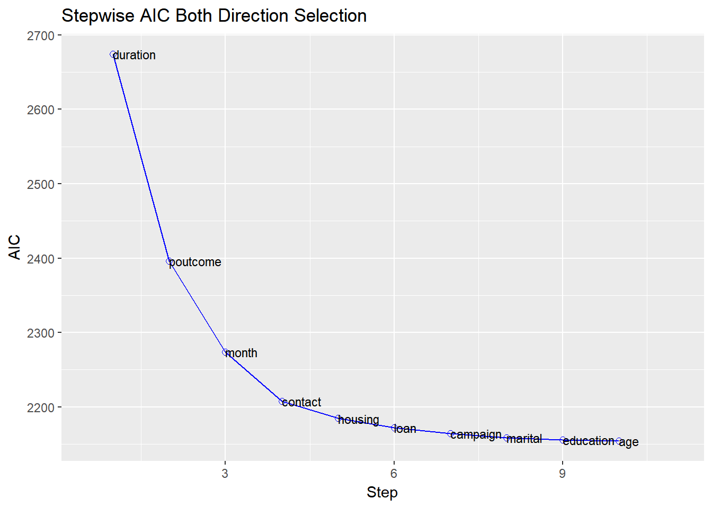

## Regression Output

### Model

We can use bivariate analysis and stepwise selection procedure to
shortlist predictors and build the model using the
[`glm()`](https://rdrr.io/r/stats/glm.html). The predictors used in the
below model are for illustration purposes and not necessarily
shortlisted from the bivariate analysis and variable selection
procedures.

`model`` ``<-`` `[`glm`](https://rdrr.io/r/stats/glm.html)`(``y`` ``~`` ``age`` ``+`` ``duration`` ``+`` ``previous`` ``+`` ``housing`` ``+`` ``default`` ``+`` `` ``loan`` ``+`` ``poutcome`` ``+`` ``job`` ``+`` ``marital``, data ``=`` ``bank_marketing``, `` `` family ``=`` `[`binomial`](https://rdrr.io/r/stats/family.html)`(``link ``=`` ``'logit'``)``)`

Use
[`blr_regress()`](https://blorr.rsquaredacademy.com/reference/blr_regress.md)
to generate comprehensive regression output. It accepts either of the
following

- model built using [`glm()`](https://rdrr.io/r/stats/glm.html)
- model formula and data

#### Using Model

Let us look at the output generated from
[`blr_regress()`](https://blorr.rsquaredacademy.com/reference/blr_regress.md):

[`blr_regress`](https://blorr.rsquaredacademy.com/reference/blr_regress.md)`(``model``)`` ``#> Model Overview `` ``#> ------------------------------------------------------------------------`` ``#> Data Set Resp Var Obs. Df. Model Df. Residual Convergence `` ``#> ------------------------------------------------------------------------`` ``#> data y 4521 4520 4498 TRUE `` ``#> ------------------------------------------------------------------------`` ``#> `` ``#> Response Summary `` ``#> --------------------------------------------------------`` ``#> Outcome Frequency Outcome Frequency `` ``#> --------------------------------------------------------`` ``#> 0 4004 1 517 `` ``#> --------------------------------------------------------`` ``#> `` ``#> Maximum Likelihood Estimates `` ``#> -----------------------------------------------------------------------`` ``#> Parameter DF Estimate Std. Error z value Pr(>|z|) `` ``#> -----------------------------------------------------------------------`` ``#> (Intercept) 1 -5.1347 0.3728 -13.7729 0.0000 `` ``#> age 1 0.0096 0.0067 1.4299 0.1528 `` ``#> duration 1 0.0042 2e-04 20.7853 0.0000 `` ``#> previous 1 -0.0357 0.0392 -0.9089 0.3634 `` ``#> housingno 1 0.7894 0.1232 6.4098 0.0000 `` ``#> defaultyes 1 -0.8691 0.6919 -1.2562 0.2091 `` ``#> loanno 1 0.6598 0.1945 3.3925 7e-04 `` ``#> poutcomefailure 1 0.6085 0.2012 3.0248 0.0025 `` ``#> poutcomeother 1 1.1354 0.2700 4.2057 0.0000 `` ``#> poutcomesuccess 1 3.2481 0.2462 13.1913 0.0000 `` ``#> jobtechnician 1 -0.2713 0.1806 -1.5019 0.1331 `` ``#> jobentrepreneur 1 -0.7041 0.3809 -1.8486 0.0645 `` ``#> jobblue-collar 1 -0.6132 0.1867 -3.2851 0.0010 `` ``#> jobunknown 1 -0.9932 0.8226 -1.2073 0.2273 `` ``#> jobretired 1 0.3197 0.2729 1.1713 0.2415 `` ``#> jobadmin. 1 0.1120 0.2001 0.5599 0.5755 `` ``#> jobservices 1 -0.1750 0.2265 -0.7728 0.4397 `` ``#> jobself-employed 1 -0.1408 0.3009 -0.4680 0.6398 `` ``#> jobunemployed 1 -0.6581 0.3432 -1.9174 0.0552 `` ``#> jobhousemaid 1 -0.7456 0.3932 -1.8963 0.0579 `` ``#> jobstudent 1 0.1927 0.3433 0.5613 0.5746 `` ``#> maritalsingle 1 0.5451 0.1387 3.9299 1e-04 `` ``#> maritaldivorced 1 -0.1989 0.1986 -1.0012 0.3167 `` ``#> -----------------------------------------------------------------------`` ``#> `` ``#> Association of Predicted Probabilities and Observed Responses `` ``#> ---------------------------------------------------------------`` ``#> % Concordant 0.8886 Somers' D 0.7773 `` ``#> % Discordant 0.1114 Gamma 0.7773 `` ``#> % Tied 0.0000 Tau-a 0.1575 `` ``#> Pairs 2070068 c 0.8886 `` ``#> ---------------------------------------------------------------`

If you want to examine the odds ratio estimates, set `odd_conf_limit` to
`TRUE`. The odds ratio estimates are not explicitly computed as we
observed considerable increase in computation time when dealing with
large data sets.

#### Using Formula

Let us use the model formula and the data set to generate the above
results.

[`blr_regress`](https://blorr.rsquaredacademy.com/reference/blr_regress.md)`(``y`` ``~`` ``age`` ``+`` ``duration`` ``+`` ``previous`` ``+`` ``housing`` ``+`` ``default`` ``+`` `` ``loan`` ``+`` ``poutcome`` ``+`` ``job`` ``+`` ``marital``, data ``=`` ``bank_marketing``)`` ``#> Model Overview `` ``#> ------------------------------------------------------------------------`` ``#> Data Set Resp Var Obs. Df. Model Df. Residual Convergence `` ``#> ------------------------------------------------------------------------`` ``#> data y 4521 4520 4498 TRUE `` ``#> ------------------------------------------------------------------------`` ``#> `` ``#> Response Summary `` ``#> --------------------------------------------------------`` ``#> Outcome Frequency Outcome Frequency `` ``#> --------------------------------------------------------`` ``#> 0 4004 1 517 `` ``#> --------------------------------------------------------`` ``#> `` ``#> Maximum Likelihood Estimates `` ``#> -----------------------------------------------------------------------`` ``#> Parameter DF Estimate Std. Error z value Pr(>|z|) `` ``#> -----------------------------------------------------------------------`` ``#> (Intercept) 1 -5.1347 0.3728 -13.7729 0.0000 `` ``#> age 1 0.0096 0.0067 1.4299 0.1528 `` ``#> duration 1 0.0042 2e-04 20.7853 0.0000 `` ``#> previous 1 -0.0357 0.0392 -0.9089 0.3634 `` ``#> housingno 1 0.7894 0.1232 6.4098 0.0000 `` ``#> defaultyes 1 -0.8691 0.6919 -1.2562 0.2091 `` ``#> loanno 1 0.6598 0.1945 3.3925 7e-04 `` ``#> poutcomefailure 1 0.6085 0.2012 3.0248 0.0025 `` ``#> poutcomeother 1 1.1354 0.2700 4.2057 0.0000 `` ``#> poutcomesuccess 1 3.2481 0.2462 13.1913 0.0000 `` ``#> jobtechnician 1 -0.2713 0.1806 -1.5019 0.1331 `` ``#> jobentrepreneur 1 -0.7041 0.3809 -1.8486 0.0645 `` ``#> jobblue-collar 1 -0.6132 0.1867 -3.2851 0.0010 `` ``#> jobunknown 1 -0.9932 0.8226 -1.2073 0.2273 `` ``#> jobretired 1 0.3197 0.2729 1.1713 0.2415 `` ``#> jobadmin. 1 0.1120 0.2001 0.5599 0.5755 `` ``#> jobservices 1 -0.1750 0.2265 -0.7728 0.4397 `` ``#> jobself-employed 1 -0.1408 0.3009 -0.4680 0.6398 `` ``#> jobunemployed 1 -0.6581 0.3432 -1.9174 0.0552 `` ``#> jobhousemaid 1 -0.7456 0.3932 -1.8963 0.0579 `` ``#> jobstudent 1 0.1927 0.3433 0.5613 0.5746 `` ``#> maritalsingle 1 0.5451 0.1387 3.9299 1e-04 `` ``#> maritaldivorced 1 -0.1989 0.1986 -1.0012 0.3167 `` ``#> -----------------------------------------------------------------------`` ``#> `` ``#> Association of Predicted Probabilities and Observed Responses `` ``#> ---------------------------------------------------------------`` ``#> % Concordant 0.8886 Somers' D 0.7773 `` ``#> % Discordant 0.1114 Gamma 0.7773 `` ``#> % Tied 0.0000 Tau-a 0.1575 `` ``#> Pairs 2070068 c 0.8886 `` ``#> ---------------------------------------------------------------`

## Model Fit Statistics

Model fit statistics are available to assess how well the model fits the
data and to compare two different models.The output includes likelihood
ratio test, AIC, BIC and a host of pseudo r-squared measures. You can
read more about pseudo r-squared
[here](https://stats.oarc.ucla.edu/other/mult-pkg/faq/general/faq-what-are-pseudo-r-squareds/).

#### Single Model

[`blr_model_fit_stats`](https://blorr.rsquaredacademy.com/reference/blr_model_fit_stats.md)`(``model``)`` ``#> Model Fit Statistics `` ``#> ----------------------------------------------------------------------------------`` ``#> Log-Lik Intercept Only: -1607.330 Log-Lik Full Model: -1123.340 `` ``#> Deviance(4498): 2246.679 LR(22): 967.980 `` ``#> Prob > LR: 0.000 `` ``#> MCFadden's R2 0.301 McFadden's Adj R2: 0.287 `` ``#> ML (Cox-Snell) R2: 0.193 Cragg-Uhler(Nagelkerke) R2: 0.379 `` ``#> McKelvey & Zavoina's R2: 0.388 Efron's R2: 0.278 `` ``#> Count R2: 0.904 Adj Count R2: 0.157 `` ``#> BIC: 2440.259 AIC: 2292.679 `` ``#> ----------------------------------------------------------------------------------`

## Model Validation

### Confusion Matrix

In the event of deciding a cut-off point on the probability scores of a
logistic regression model, a confusion matrix is created corresponding
to a particular cut-off. The observations with probability scores above
the cut-off score are predicted to be events and those below the cut-off
score, as non-events. The confusion matrix, a 2X2 table, then calculates
the number of correctly classified and miss-classified observations.

[`blr_confusion_matrix`](https://blorr.rsquaredacademy.com/reference/blr_confusion_matrix.md)`(``model``, cutoff ``=`` ``0.5``)`` ``#> Confusion Matrix and Statistics `` ``#> `` ``#> Reference`` ``#> Prediction 0 1`` ``#> 0 3920 352`` ``#> 1 84 165`` ``#> `` ``#> `` ``#> Accuracy : 0.9036 `` ``#> No Information Rate : 0.8856 `` ``#> `` ``#> Kappa : 0.3851 `` ``#> `` ``#> McNemars's Test P-Value : 0.0000 `` ``#> `` ``#> Sensitivity : 0.3191 `` ``#> Specificity : 0.9790 `` ``#> Pos Pred Value : 0.6627 `` ``#> Neg Pred Value : 0.9176 `` ``#> Prevalence : 0.1144 `` ``#> Detection Rate : 0.0365 `` ``#> Detection Prevalence : 0.0551 `` ``#> Balanced Accuracy : 0.6491 `` ``#> Precision : 0.6627 `` ``#> Recall : 0.3191 `` ``#> `` ``#> 'Positive' Class : 1`

The validity of a cut-off is measured using sensitivity, specificity and
accuracy.

- **Sensitivity**: The % of correctly classified events out of all
  events = TP / (TP + FN)

- **Specificity**: The % of correctly classified non-events out of all
  non-events = TN / (TN + FP)

- **Accuracy**: The % of correctly classified observation over all
  observations = (TP + TN) / (TP + FP + TN + FN)

- *True Positive (TP)* : Events correctly classified as events.

- *True Negative (TN)* : Non-Events correctly classified as non-events.

- *False Positive (FP)*: Non-events miss-classified as events.

- *False Negative (FN)*: Events miss-classified as non-events.

For a standard logistic model, the higher is the cut-off, the lower will
be the sensitivity and the higher would be the specificity. As the
cut-off is decreased, sensitivity will go up, as then more events would
be captured. Also, specificity will go down, as more non-events would
miss-classified as events. Hence a trade-off is done based on the
requirements. For example, if we are looking to capture as many events
as possible, and we can afford to have miss-classified non-events, then
a low cut-off is taken.

### Hosmer Lemeshow Test

Hosmer and Lemeshow developed a goodness-of-fit test for logistic
regression models with binary responses. The test involves dividing the
data into approximately ten groups of roughly equal size based on the
percentiles of the estimated probabilities. The observations are sorted
in increasing order of their estimated probability of having an even
outcome. The discrepancies between the observed and expected number of
observations in these groups are summarized by the Pearson chi-square
statistic, which is then compared to chi-square distribution with t
degrees of freedom, where t is the number of groups minus 2. Lower
values of Goodness-of-fit are preferred.

[`blr_test_hosmer_lemeshow`](https://blorr.rsquaredacademy.com/reference/blr_test_hosmer_lemeshow.md)`(``model``)`` ``#> Partition for the Hosmer & Lemeshow Test `` ``#> --------------------------------------------------------------`` ``#> def = 1 def = 0 `` ``#> Group Total Observed Expected Observed Expected `` ``#> --------------------------------------------------------------`` ``#> 1 453 2 5.14 451 447.86 `` ``#> 2 452 3 8.63 449 443.37 `` ``#> 3 452 4 11.88 448 440.12 `` ``#> 4 452 7 15.29 445 436.71 `` ``#> 5 452 14 19.39 438 432.61 `` ``#> 6 452 10 24.97 442 427.03 `` ``#> 7 452 31 33.65 421 418.35 `` ``#> 8 452 62 49.74 390 402.26 `` ``#> 9 452 128 88.10 324 363.90 `` ``#> 10 452 256 260.21 196 191.79 `` ``#> --------------------------------------------------------------`` ``#> `` ``#> Goodness of Fit Test `` ``#> ------------------------------`` ``#> Chi-Square DF Pr > ChiSq `` ``#> ------------------------------`` ``#> 52.9942 8 0.0000 `` ``#> ------------------------------`

### Gains Table & Lift Chart

A lift curve is a graphical representation of the % of cumulative events
captured at a specific cut-off. The cut-off can be a particular decile
or a percentile. Similar, to rank ordering procedure, the data is in
descending order of the scores and is then grouped into
deciles/percentiles. The cumulative number of observations and events
are then computed for each decile/percentile. The lift curve is the
created using the cumulative % population as the x-axis and the
cumulative percentage of events as the y-axis.

[`blr_gains_table`](https://blorr.rsquaredacademy.com/reference/blr_gains_table.md)`(``model``)`` ``#> decile total 1 0 ks tp tn fp fn sensitivity specificity`` ``#> 1 1 452 256 196 44.62134 256 3808 196 261 49.51644 95.10490`` ``#> 2 2 452 128 324 61.28765 384 3484 520 133 74.27466 87.01299`` ``#> 3 3 452 62 390 63.53965 446 3094 910 71 86.26692 77.27273`` ``#> 4 4 452 31 421 59.02130 477 2673 1331 40 92.26306 66.75824`` ``#> 5 5 452 10 442 49.91657 487 2231 1773 30 94.19729 55.71928`` ``#> 6 6 452 14 438 41.68544 501 1793 2211 16 96.90522 44.78022`` ``#> 7 7 452 7 445 31.92552 508 1348 2656 9 98.25919 33.66633`` ``#> 8 8 452 4 448 21.51040 512 900 3104 5 99.03288 22.47752`` ``#> 9 9 452 3 449 10.87689 515 451 3553 2 99.61315 11.26374`` ``#> 10 10 453 2 451 0.00000 517 0 4004 0 100.00000 0.00000`` ``#> accuracy`` ``#> 1 89.89162`` ``#> 2 85.55629`` ``#> 3 78.30126`` ``#> 4 69.67485`` ``#> 5 60.11944`` ``#> 6 50.74099`` ``#> 7 41.05286`` ``#> 8 31.23203`` ``#> 9 21.36695`` ``#> 10 11.43552`

#### Lift Chart

`model`` `[`%>%`](https://magrittr.tidyverse.org/reference/pipe.html)` `` `[`blr_gains_table`](https://blorr.rsquaredacademy.com/reference/blr_gains_table.md)`(``)`` `[`%>%`](https://magrittr.tidyverse.org/reference/pipe.html)` `` `[`plot`](https://rdrr.io/r/graphics/plot.default.html)`(``)`

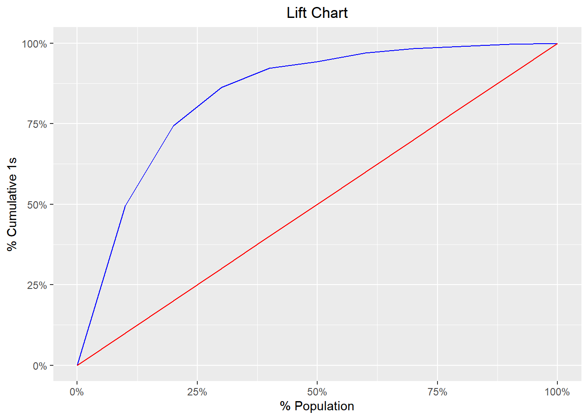

### ROC Curve

ROC curve is a graphical representation of the validity of cut-offs for
a logistic regression model. The ROC curve is plotted using the
sensitivity and specificity for all possible cut-offs, i.e., all the
probability scores. The graph is plotted using sensitivity on the y-axis
and 1-specificity on the x-axis. Any point on the ROC curve represents a
sensitivity X (1-specificity) measure corresponding to a cut-off. The
area under the ROC curve is used as a validation measure for the model –
the bigger the area the better is the model.

`model`` `[`%>%`](https://magrittr.tidyverse.org/reference/pipe.html)` `` `[`blr_gains_table`](https://blorr.rsquaredacademy.com/reference/blr_gains_table.md)`(``)`` `[`%>%`](https://magrittr.tidyverse.org/reference/pipe.html)` `` `[`blr_roc_curve`](https://blorr.rsquaredacademy.com/reference/blr_roc_curve.md)`(``)`

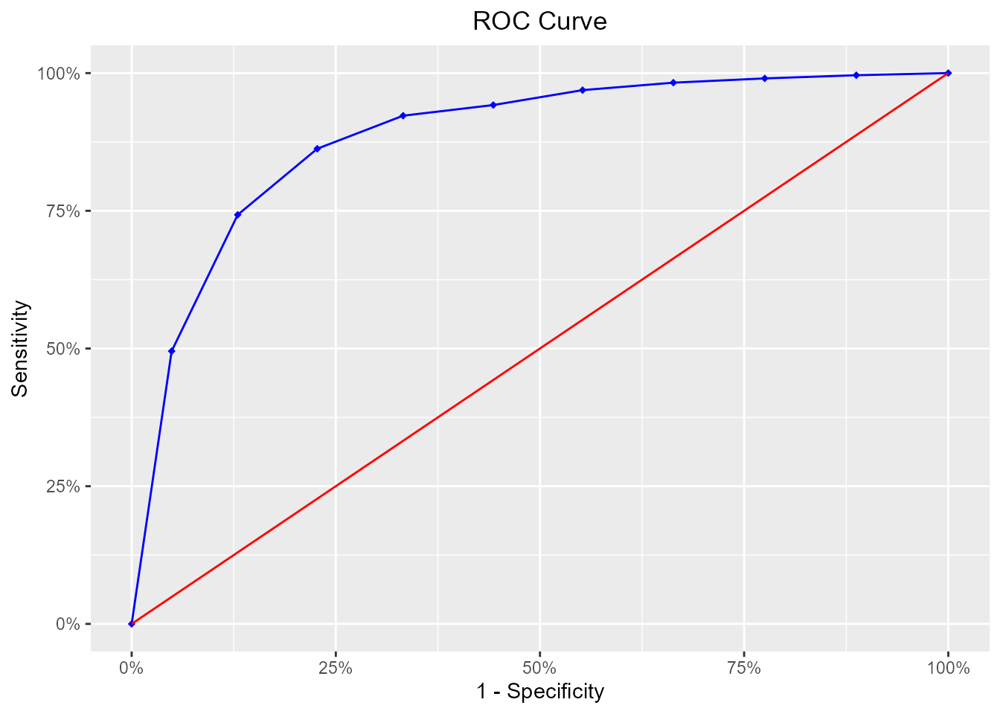

### KS Chart

The KS Statistic is again a measure of model efficiency, and it is
created using the lift curve. The lift curve is created to plot %
events. If we also plot % non-events on the same scale, with %
population at x-axis, we would get another curve. The maximum distance
between the lift curve for events and that for non-events is termed as
KS. For a good model, KS should be big (\>=0.3) and should occur as
close to the event rate as possible.

`model`` `[`%>%`](https://magrittr.tidyverse.org/reference/pipe.html)` `` `[`blr_gains_table`](https://blorr.rsquaredacademy.com/reference/blr_gains_table.md)`(``)`` `[`%>%`](https://magrittr.tidyverse.org/reference/pipe.html)` `` `[`blr_ks_chart`](https://blorr.rsquaredacademy.com/reference/blr_ks_chart.md)`(``)`

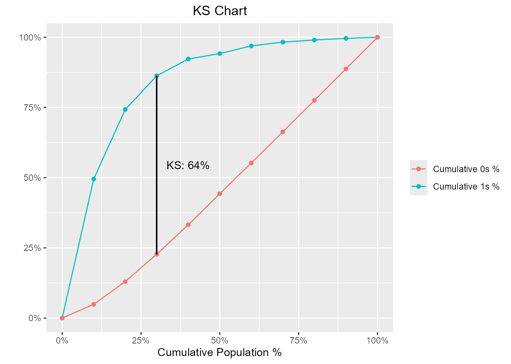

### Decile Lift Chart

The decile lift chart displays the lift over the global mean event rate
for each decile. For a model with good discriminatory power, the top
deciles should have an event/conversion rate greater than the global
mean.

`model`` `[`%>%`](https://magrittr.tidyverse.org/reference/pipe.html)` `` `[`blr_gains_table`](https://blorr.rsquaredacademy.com/reference/blr_gains_table.md)`(``)`` `[`%>%`](https://magrittr.tidyverse.org/reference/pipe.html)` `` `[`blr_decile_lift_chart`](https://blorr.rsquaredacademy.com/reference/blr_decile_lift_chart.md)`(``)`

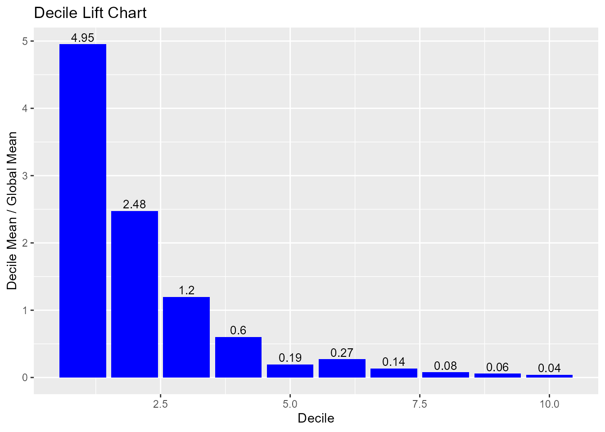

### Capture Rate by Decile

If the model has good discriminatory power, the top deciles should have
a higher event/conversion rate compared to the bottom deciles.

`model`` `[`%>%`](https://magrittr.tidyverse.org/reference/pipe.html)` `` `[`blr_gains_table`](https://blorr.rsquaredacademy.com/reference/blr_gains_table.md)`(``)`` `[`%>%`](https://magrittr.tidyverse.org/reference/pipe.html)` `` `[`blr_decile_capture_rate`](https://blorr.rsquaredacademy.com/reference/blr_decile_capture_rate.md)`(``)`

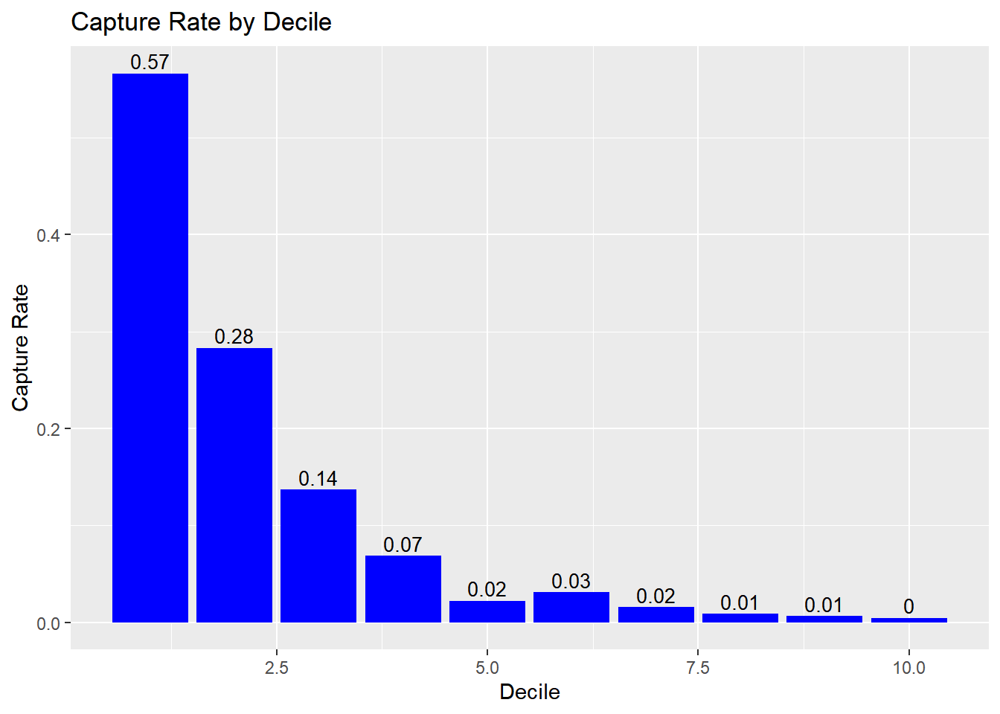

### Lorenz Curve

The Lorenz curve is a simple graphic device which illustrates the degree
of inequality in the distribution of thevariable concerned. It is a
visual representation of inequality used to measure the discriminatory
power of the predictive model.

[`blr_lorenz_curve`](https://blorr.rsquaredacademy.com/reference/blr_lorenz_curve.md)`(``model``)`

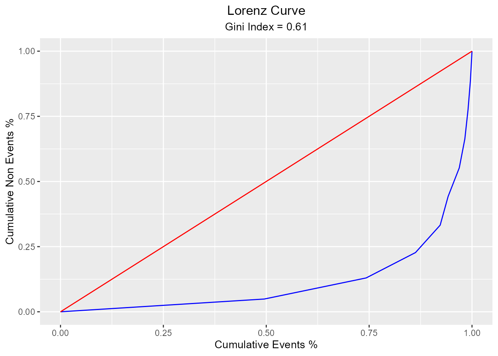

## Residual & Influence Diagnostics

**blorr** can generate 22 plots for residual, influence and leverage
diagnostics.

#### Influence Diagnostics

[`blr_plot_diag_influence`](https://blorr.rsquaredacademy.com/reference/blr_plot_diag_influence.md)`(``model``)`

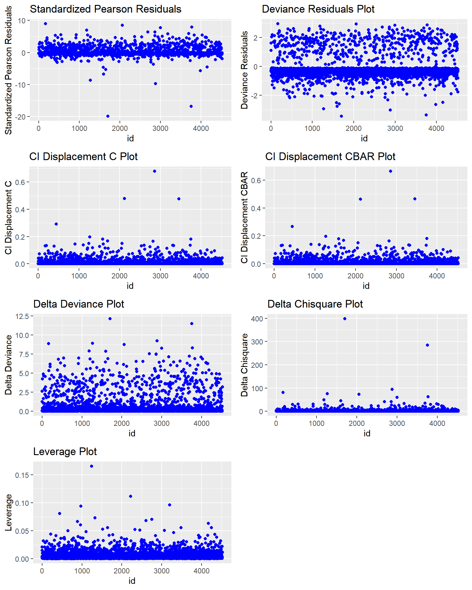

#### Leverage Diagnostics

[`blr_plot_diag_leverage`](https://blorr.rsquaredacademy.com/reference/blr_plot_diag_leverage.md)`(``model``)`

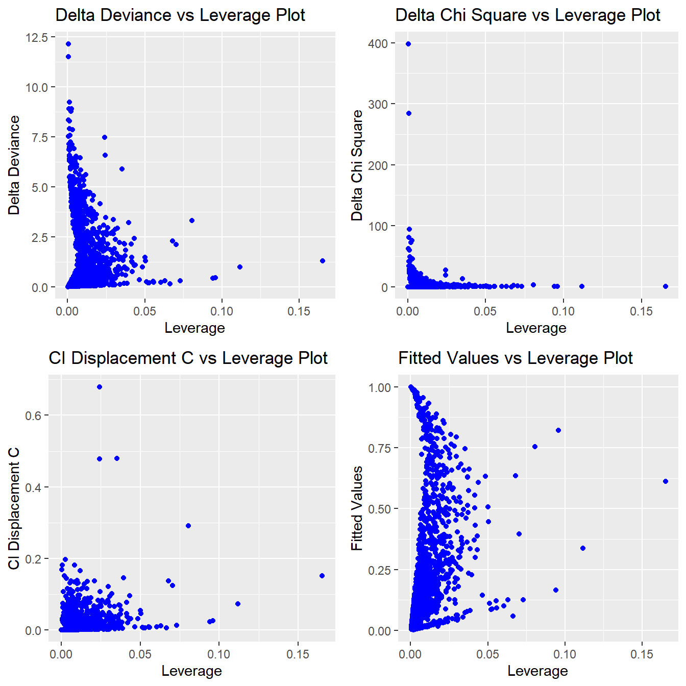

#### Fitted Values Diagnostics

[`blr_plot_diag_fit`](https://blorr.rsquaredacademy.com/reference/blr_plot_diag_fit.md)`(``model``)`

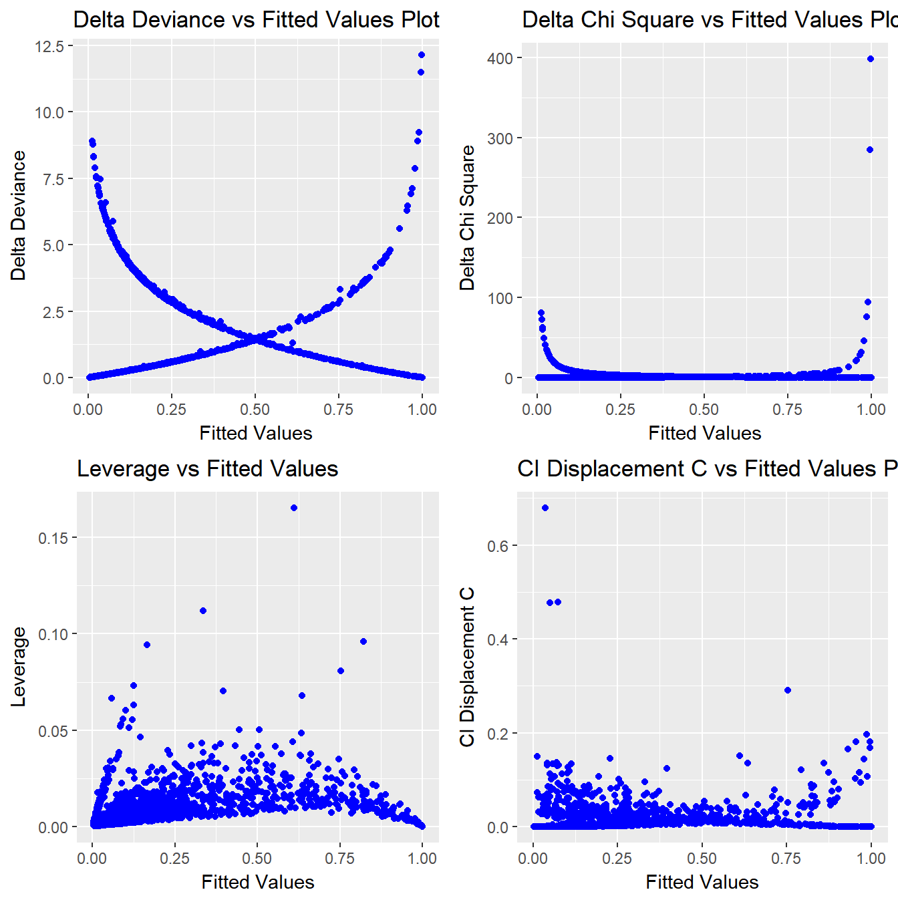
